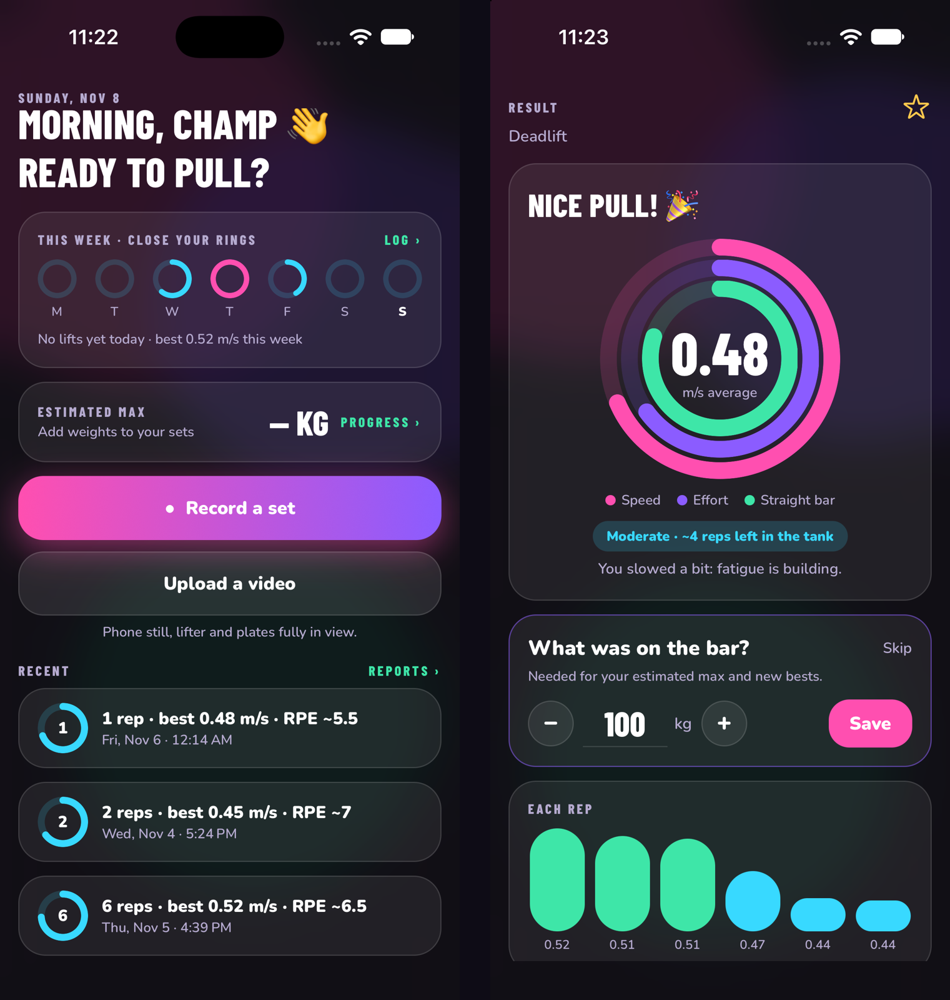

# LiftSpeed

**Film a deadlift on your phone. Get bar speed, reps, effort and an estimated 1-rep max.**
Velocity-based training usually needs a dedicated bar sensor. LiftSpeed does it with the camera you already have.

> In active development as a possible product, so the code is private. This page shows how it works.

## What it does

- **Fully automatic tracking.** Finds the lifter, finds the weight plate, uses the plate's known 45 cm size as a ruler, and tracks the bar.
- **Per-rep numbers.** Speed (m/s), slowdown across the set, sticking point, bar drift and an RPE estimate.
- **Replay with the bar path** drawn on the video, live speed and rep count. Export it as a 1080p video to share.
- **Progress.** Estimated 1RM from the speed-vs-weight curve, suggested training weights, trends over time.

## How it's built

| Part | Tech |
|---|---|
| App | React Native (Expo), TypeScript, custom camera with pro controls (exposure, focus lock, zoom) |
| Tracker | Plain JavaScript in a WebView: pose model → plate detection → tracking → rep detection |
| Export | Canvas + MediaRecorder → mp4 → share sheet |
| Data | On-device history, optional cloud reports (Firebase) |
| Quality | Regression clips: every tracker change must reproduce known speeds on a set of real videos |

## Hard problems solved

- **Scale from a phone video.** No markers or calibration: the standard plate size becomes the ruler.
- **Messy real-world clips.** Blurry plates, long setups before the pull, the plate leaving the frame. Each one got a fallback that only runs when the main path fails, so accuracy on good clips never drifts.

## What I learned

- Lock in a baseline before tuning an algorithm. One "small" change once shifted every clip's speed by up to 20%.
- Test on the real device early. The camera and video export behave differently than in the simulator.
